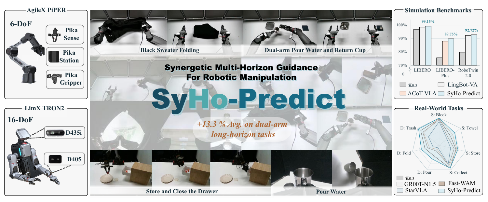
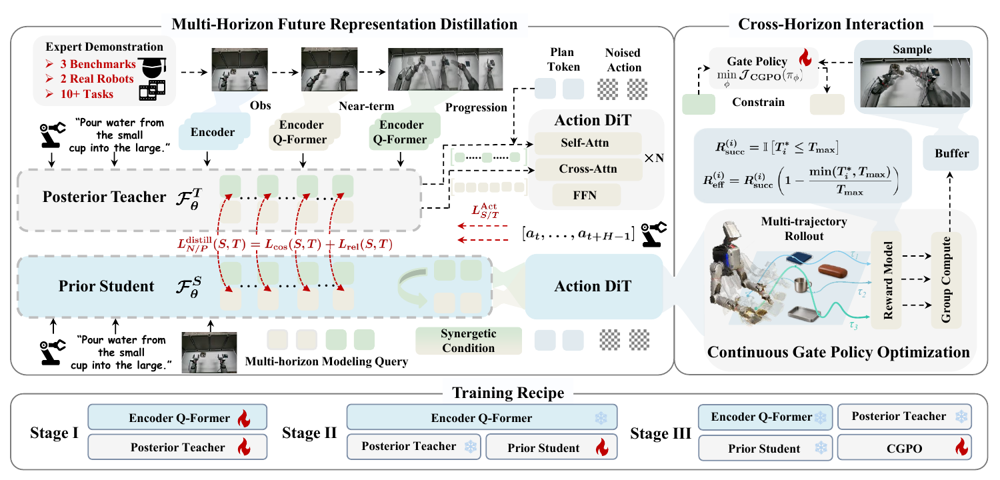

# SyHo-Predict

**Endowing World-Action Models with Synergetic Multi-Horizon Foresight**

<p align="center">
  
</p>

SyHo-Predict learns complementary **near-term dynamics** and **long-horizon task progression** to guide robot actions. This repository contains the research code for Stage I / II / III training and inference on **LIBERO, LIBERO-Plus, and RoboTwin 2.0**, together with experiment and ablation scripts.

## Framework

<p align="center">
  
</p>

1. **Stage I — Posterior teacher:** encode future demonstrations into multi-horizon representations and train the action policy.
2. **Stage II — Prior student:** distill the frozen teacher into a policy that predicts these representations from current observations.
3. **Stage III — CGPO:** optimize continuous gates controlling cross-horizon interactions using task success and efficiency rewards.

At deployment, the student uses current visual observations and language instructions; future demonstrations are only used during training. Some implementation filenames retain the experimental name “GRPO”; the paper calls the gating method **Continuous Gating Policy Optimization (CGPO)**.

## Getting started

Use a **new environment** with Python 3.10. The model environment export is [requirement.txt](requirement.txt); CUDA-dependent packages and the separate simulator environments are described in [Environment setup](docs/ENVIRONMENTS.md).

```bash
git clone https://github.com/PhilVictorW/SyHo-Predict.git
cd SyHo-Predict
python -m pip install -r requirement.txt

cp configs/paths.example.json configs/paths.local.json
# Edit paths.local.json for your data, weights, interpreters, and simulator.
python scripts/configure_paths.py --config configs/paths.local.json
python scripts/configure_paths.py --config configs/paths.local.json --apply
```

| Benchmark | Stage I / II | Stage III |
| --- | --- | --- |
| LIBERO | `goal_local/` | `stage_III/libero/` |
| LIBERO-Plus | `libero-plus/runtime/` | `stage_III/libero_plus/` |
| RoboTwin 2.0 | `robotwin/` | `stage_III/robotwin/` |

See **[Training and inference](docs/WORKFLOWS.md)** for commands, checkpoint lineage, and evaluation entry points. **[Assets and checkpoints](docs/ASSETS.md)** describes external inputs. The [Hugging Face checkpoint archive](https://huggingface.co/Phil-V/SyHo-Predict-models) currently requires access.

This is a source release of the research workspace. Datasets, model weights, simulator assets, caches, and generated outputs are stored separately. Historical launchers retain experiment-specific assumptions; the release has been checked statically, without rerunning training or benchmark evaluation. Figures summarize the paper and are not a claim that every archived checkpoint reproduces every reported result.

## Acknowledgments

Built on LaWAM and the LIBERO, LIBERO-Plus, and RoboTwin ecosystems. Original package attribution and bundled third-party license notices are retained; see [Third-party notices](docs/THIRD_PARTY_NOTICES.md).
